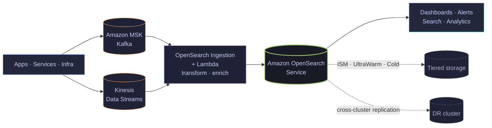

<!-- ═══════════════════════════ HEADER ═══════════════════════════ -->

  

  

 

  
  &nbsp;
  
  &nbsp;
  
  &nbsp;
  
  &nbsp;
  

 

<!-- ═══════════════════════════ ABOUT ═══════════════════════════ -->
## 👋 About me

I'm a **Cloud Engineer II at Amazon Web Services** in Toronto 🇨🇦, where I own the hardest enterprise escalations and architecture engagements for **Amazon OpenSearch Service** and streaming workloads.

Day to day that means shard and allocation strategy, JVM heap and circuit-breaker tuning, **ISM / UltraWarm / cold-tier** lifecycle design for petabyte-scale log analytics, **cross-cluster replication** for DR, and end-to-end pipelines on **Amazon MSK (Kafka)**, **Kinesis**, **Lambda** and **OpenSearch Ingestion**.

Before AWS I was an SRE at **Societe Generale** and **Splunk**, so I think in SLOs, runbooks and root-cause analyses. Lately I'm building with **Amazon Bedrock**, **Anthropic Claude**, **MCP servers** and AI agents.

  
  
  
  

 

<!-- ═══════════════════════════ WHAT I BUILD ═══════════════════════════ -->
## 🧭 What I build

A typical platform I design and stabilize: high-volume logs, metrics and events streamed in, transformed in flight, indexed in OpenSearch, and tiered for cost.

 

<!-- ═══════════════════════════ TECH STACK ═══════════════════════════ -->
## 🛠️ Tech stack

<table align="center">
  <tr>
    <td align="right"><b>☁️ Cloud</b></td>
    <td>
      
      
      
      
      
      
      
      
    </td>
  </tr>
  <tr>
    <td align="right"><b>🔎 Search &amp; streaming</b></td>
    <td>
      
      
      
      
      
    </td>
  </tr>
  <tr>
    <td align="right"><b>⚙️ DevOps &amp; IaC</b></td>
    <td>
      
      
      
      
      
      
      
      
      
      
    </td>
  </tr>
  <tr>
    <td align="right"><b>📡 Observability</b></td>
    <td>
      
      
      
      
      
    </td>
  </tr>
  <tr>
    <td align="right"><b>🤖 AI &amp; GenAI</b></td>
    <td>
      
      
      
      
      
      
    </td>
  </tr>
  <tr>
    <td align="right"><b>💻 Languages</b></td>
    <td>
      
      
      
      
      
      
      
      
      
    </td>
  </tr>
  <tr>
    <td align="right"><b>🧰 Frameworks &amp; tools</b></td>
    <td>
      
      
      
      
      
      
      
      
    </td>
  </tr>
</table>

 

<!-- ═══════════════════════════ EXPERIENCE ═══════════════════════════ -->
## 💼 Experience

| | Role | Company | When |
|:-:|:--|:--|:--|
| 🟠 | **Cloud Engineer II** | Amazon Web Services · Toronto | Aug 2026 – Present |
| 🟠 | **Cloud Engineer I** · OpenSearch SME | Amazon Web Services · Toronto | Nov 2024 – Aug 2026 |
| 🔴 | **Site Reliability Engineer** | Societe Generale · Montreal | Jul 2024 – Nov 2024 |
| 🟢 | **DevOps Engineer** (part-time) | VCare Networks · Remote | Jan 2024 – Jun 2024 |
| 🔵 | **DevOps Engineer Intern** | Tecsys · Montreal | Sep 2023 – Dec 2023 |
| 🟣 | **Site Reliability Engineer** | Splunk · Ahmedabad | Dec 2020 – Aug 2022 |

<b>Highlights by role</b> (click to expand)

 

**Amazon Web Services**
- Promoted to Cloud Engineer II for depth in Amazon OpenSearch Service and streaming architectures; own the most complex enterprise escalations.
- Built end-to-end ingestion pipelines (Kafka, Kinesis, Lambda, OpenSearch Ingestion) with in-flight transformation and enrichment.
- Led OpenSearch performance engineering: shard sizing and allocation, JVM heap and circuit breakers, segment merge policies.
- Designed ISM / UltraWarm / cold-tier lifecycle architectures that cut storage cost for petabyte-scale log analytics.
- Architected cross-cluster replication and multi-AZ domains for DR and read scaling.
- Deployed EKS microservices infrastructure with Terraform; partnered with TAMs on on-prem to AWS migrations.
- Mentor engineers on OpenSearch and Kafka troubleshooting; author internal runbooks.

**Societe Generale**
- Release management and deployments for the Border (US) and Maple (Canada) projects with Jenkins, Argo CD and GitHub.
- Monitoring with Dynatrace, AppDynamics, Grafana and Splunk; scheduling with Autosys; automation in Ansible, Python and Bash.

**Tecsys**
- GitLab pipelines for Kubernetes microservice deployments; cut infrastructure-related build failures by 98%.

**Splunk**
- Ran large indexer and search-head clusters; onboarded data sources, wrote SPL, dashboards and alerts.
- On-call for escalated incidents (300+ debugged); incident response, RCAs and preventive automation.

 

<!-- ═══════════════════════════ EDUCATION ═══════════════════════════ -->
## 🎓 Education

| | Degree | School | When |
|:-:|:--|:--|:--|
| 🎓 | **Master of Software Engineering** | Concordia University · Montreal | 2022 – 2024 |
| 🎓 | **B.Tech, Information Technology** | Dharmsinh Desai University · Nadiad | 2017 – 2021 |

 

<!-- ═══════════════════════════ GITHUB STATS ═══════════════════════════ -->
## 📊 GitHub

  
  

  

  

  

 

<!-- ═══════════════════════════ FOOTER ═══════════════════════════ -->

  <i>Open to conversations about OpenSearch, Kafka, observability and GenAI on AWS. Say hi on <a href="https://www.linkedin.com/in/chetan2709/">LinkedIn</a>.</i>

