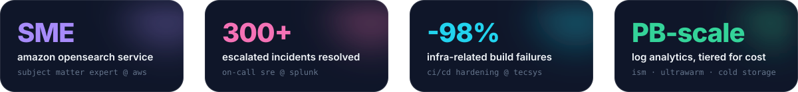
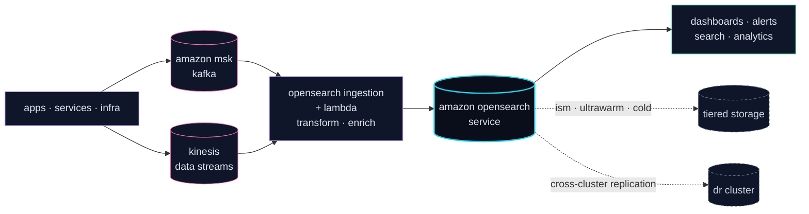
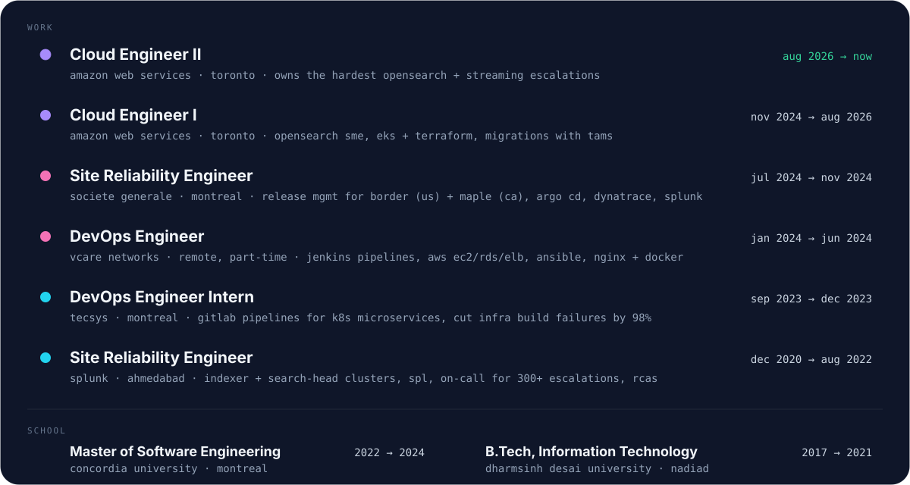

<div align="center">
  
</div>

<div align="center">
  
</div>

<p align="center">
  <a href="https://www.linkedin.com/in/chetan2709/"></a>
  &nbsp;&nbsp;
  <a href="mailto:chetan.panchal270999@gmail.com"></a>
</p>

<br/>

### about

```console
$ whoami
cloud engineer ii @ amazon web services, toronto 🇨🇦
i own the gnarliest opensearch + streaming escalations and make clusters behave

$ cat ~/now.txt
→ tuning opensearch at enterprise scale: shards, jvm heap, circuit breakers, ism / ultrawarm tiers
→ streaming pipelines: kafka (msk) · kinesis · lambda → opensearch ingestion
→ building with amazon bedrock, claude and mcp servers
→ mentoring engineers + writing the runbooks i wish i'd had

$ history | grep -i sre
societe generale (montreal) · splunk (ahmedabad)
```

<div align="center">
  
</div>

<br/>

### what i build



<br/>

### stack

<div align="center">
  
</div>

<div align="center">
  
</div>

<br/>

### where i've been

<div align="center">
  
</div>

<br/>

### github

<div align="center">
  
  
</div>

<div align="center">
  
</div>

<div align="center">
  
</div>

<br/>

<div align="center">
  <sub>thanks for scrolling · say hi on <a href="https://www.linkedin.com/in/chetan2709/">linkedin</a></sub>
</div>
